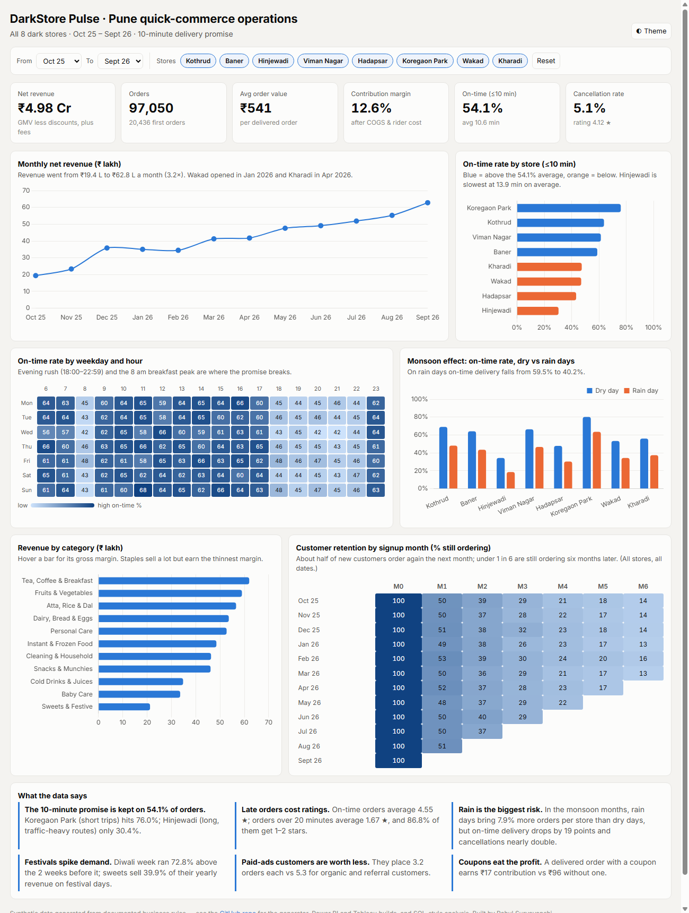
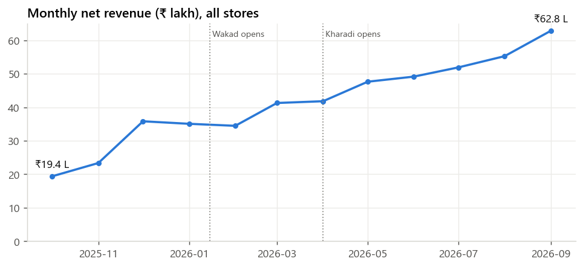
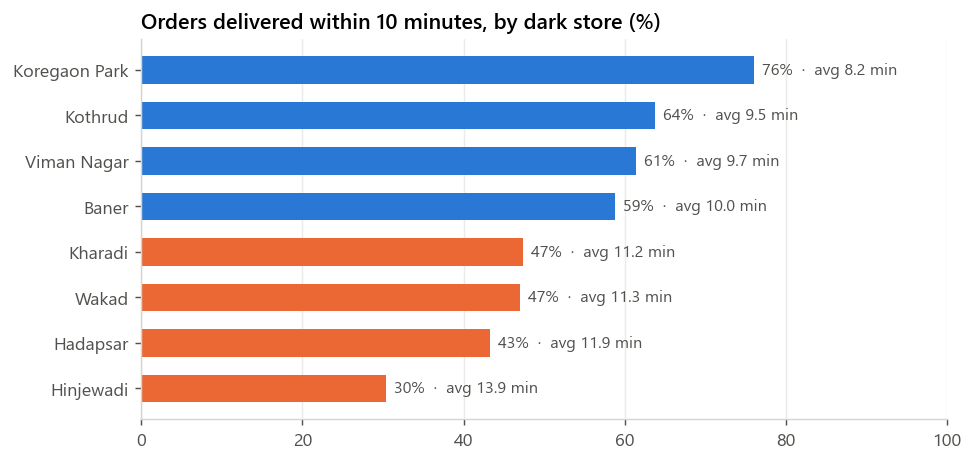
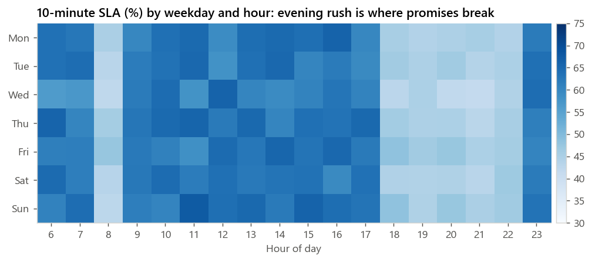
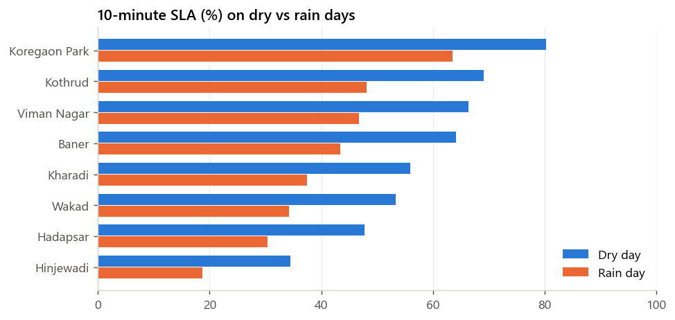
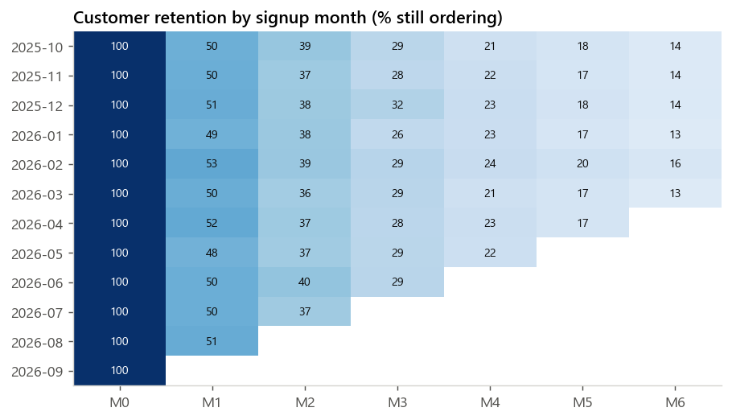
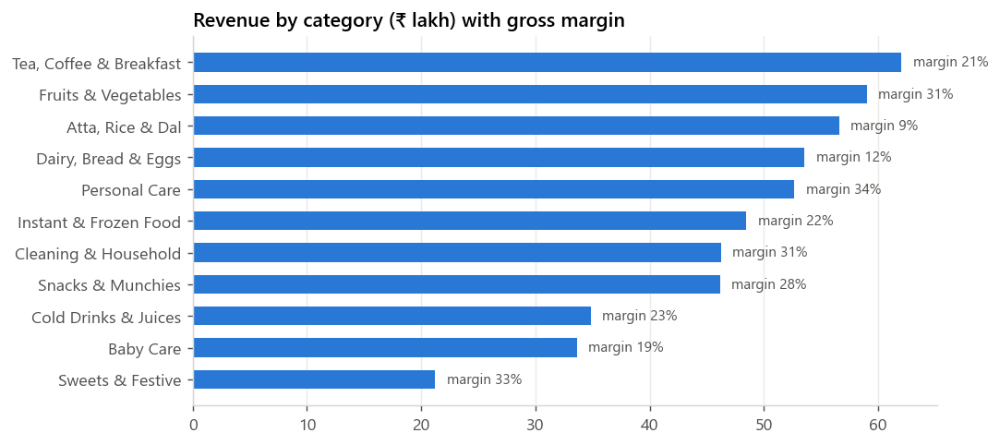

# DarkStore Pulse: Quick-Commerce Operations Analytics (Power BI · Tableau · Python)

**Can a 10-minute delivery promise survive Pune's evening rush, the monsoon and Diwali?**

An end-to-end BI project on a quick-commerce business (Blinkit / Zepto / Instamart style) running
**8 dark stores across Pune**: **97,050 orders, 305k order lines, 20,436 customers, 12 months
(Oct 2025 – Sep 2026)**. The same star-schema dataset is analysed three ways:

| | What | Where |
|---|---|---|
| 🌐 | **Live interactive dashboard**: filters, hover tooltips, dark mode | **[Open the dashboard](https://rahulsuryvanshi810.github.io/darkstore-pulse-bi/)** · `docs/` |
| 📊 | **Power BI project** (`powerbi/DarkStore_Pulse/DarkStore_Pulse.pbip`): data model, 57 DAX measures, 3 report pages; guide for what-if SLA slider, drill-through, RLS | [`powerbi/`](powerbi/) |
| 📈 | **Tableau workbook** (`tableau/DarkStore_Pulse.twb`): connected data, 35 calculated fields (LOD, table calcs), 3 parameters; guide for map, set actions, 5-point Story | [`tableau/`](tableau/) |
| 🐍 | **Python pipeline**: data generator, analysis, charts, 8 data-quality tests | `scripts/`, `tests/` |



---

## Business questions and answers

| # | Question | Answer |
|---|---|---|
| 1 | How big is the business, and is it growing? | **₹4.98 Cr net revenue**, 97,050 orders, AOV **₹541**. Monthly revenue grew **3.2×** (₹19.4 L → ₹62.8 L) as Wakad (Jan) and Kharadi (Apr) stores opened. |
| 2 | Is the 10-minute promise kept? | Only on **54.1%** of orders (average 10.6 min, median 9.6). |
| 3 | Which stores break it? | **Koregaon Park 76%** (short 1.3 km trips) vs **Hinjewadi 30%** (2.3 km, IT-park traffic, 13.9 min average). |
| 4 | When does it break? | Evening rush (18:00–22:59) and the 8 am breakfast peak carry 48% of orders; on-time falls to **44.9%** vs **62.6%** off-peak. |
| 5 | What does the monsoon do? | Rain days: on-time **59.5% → 40.2%**, average time 10.0 → 12.4 min, cancellations **4.1% → 7.7%**. Demand still rises 7.9% (monsoon months only). |
| 6 | What do late orders cost? | Ratings fall from **4.55★** (on time) to **1.67★** (20+ min); **87%** of 20+ min orders get 1–2 stars. |
| 7 | How big are festival peaks? | Diwali week **+73%** orders vs the 2 weeks before; Ganesh Chaturthi +38%, Holi +38%, New Year +35%. Sweets earn **40%** of their yearly revenue on festival days. |
| 8 | Do customers come back? | **50%** order again in month 1, **29%** in month 3; 70% of customers order more than once and they place 94% of orders. |
| 9 | Which acquisition channel is worth it? | **Paid-ads** customers place **3.2** orders each vs **5.3** for organic and referral, 39% fewer. |
| 10 | Where does margin leak? | Contribution margin **12.6%**. A coupon order earns **₹17** vs **₹96** without one. Staples (atta, rice, dal) sell well but at an 8.5% margin. |

### Recommendations
1. **Hinjewadi & Hadapsar**: split the delivery zone or add a micro-store; their average trip is 2.0–2.3 km vs 1.3–1.6 km at the best stores.
2. **Evening rush**: add 2–3 part-time riders per store from 18:00 to 23:00, when only 45% of orders arrive on time.
3. **Rain playbook**: show an honest "15-min" ETA on rain days instead of breaking the 10-minute promise, since 20+ minute orders collapse ratings.
4. **Festival stocking**: pre-stock sweets and festive SKUs one week before Diwali / Ganesh Chaturthi; sweets have the highest stockout rate (5.2% of lines vs 3.5–3.9% elsewhere).
5. **Marketing mix**: shift budget from paid ads to referrals, whose customers order 1.6× more often.
6. **Coupons**: cap first-order discounts or require a minimum basket, since coupon orders earn a fifth of normal contribution.

## Charts

| | |
|---|---|
|  |  |
|  |  |
|  |  |

## Data model (star schema)

```
            Date ─────────┐
                          ▼
 Stores ──────────────► Orders ◄────────── Customers
    └──► Riders ·······►  │ (1 row per order: money, delivery minutes, SLA, rating, weather, festival)
                          ▼
                     Order Items ◄──────── Products
                     (1 row per line)
```

| Table | Rows | Key columns |
|---|---|---|
| `orders.csv` | 97,050 | datetime, store, customer, rider, status, payment, coupon, rain, festival, item_total, discount, delivery_fee, cogs, rider_cost, net_revenue, contribution, distance_km, delivery_minutes, sla_met, rating |
| `order_items.csv` | 305,189 | order, product, quantity, mrp, unit_cost, fulfilled (0 = out of stock) |
| `customers.csv` | 20,436 | signup date, home store, acquisition channel |
| `products.csv` | 132 | 11 categories, MRP, unit cost |
| `stores.csv` | 8 | Pune area, zone, lat/long, open date, riders |
| `riders.csv` | 100 | store, EV scooter / petrol bike |
| `calendar_events.csv` | 365 | rain day flag, festival name |

**Metric definitions:** GMV = value of items ordered · Net revenue = items − discount + delivery fee (delivered
orders only) · Contribution = net revenue − cost of goods − rider payout · SLA met = delivered in ≤ 10 minutes.

## Power BI highlights

- Power Query with parameterised folder path, typed columns and null handling (`power_query.m`).
- DAX: time intelligence (MoM, MTD, running total, 7-day rolling), `RANKX` Top-N, cohort retention
  matrix, festival uplift, dynamic titles, conditional-format colour measure (`measures.dax`).
- **What-if parameter**: drag the SLA target from 10 to 12 minutes and the whole report recalculates.
- Decomposition tree and Key Influencers on SLA breaches, drill-through store page, report-page tooltip,
  bookmarks, field parameters, and row-level security per zone manager.
- Custom colour-blind-safe theme (`theme/darkstore_pulse_theme.json`).

## Tableau highlights

- Store map with size = orders and colour = on-time rate.
- LOD expressions for the cohort analysis and the city benchmark (`{FIXED ...}`).
- Table calculations (running sum, MoM %, 7-day window average, rank).
- Parameters (SLA target, metric switch, Top N), filter, highlight and **set actions**.
- A 5-point **Story** for an operations review (`tableau/README.md`).

## Run it

```bash
pip install -r requirements.txt
python scripts/generate_data.py   # rebuilds data/*.csv (fixed seed, same output every time)
python scripts/analyze.py         # outputs/*.csv, reports/figures/*.png, docs/data.js, tableau flat file
python scripts/build_bi_files.py  # Power BI project (.pbip) + Tableau workbook (.twb)
python -m pytest -q               # 8 data-quality checks
```

Open `docs/index.html` in a browser for the web dashboard.

## About the data

The data is **synthetic**, generated by `scripts/generate_data.py` from explicit business rules: store
distance and traffic, rush hours, monsoon rain probability by month, real 2025–26 festival dates, new-store
ramp-up, customer churn by acquisition channel, and stockouts. No real company's data is used. Because every
pattern has a known cause, the dashboards can be checked: the tests confirm order lines add up to order
totals, money fields reconcile, and cancelled orders have no delivery data.

## Repository layout

| Path | What |
|---|---|
| `data/` | 7 CSV tables (star schema) |
| `scripts/generate_data.py` | the data generator |
| `scripts/analyze.py` | business questions → `outputs/`, charts → `reports/figures/`, web data → `docs/data.js` |
| `powerbi/` | Power Query, DAX measures, theme, step-by-step report build guide |
| `tableau/` | flat order file, calculated fields, workbook build guide |
| `docs/` | interactive web dashboard (GitHub Pages) |
| `outputs/` | answer tables (CSV) and `findings.json` |
| `tests/` | data-quality tests |

---
Built by **Rahul Suryavanshi** · [GitHub](https://github.com/rahulsuryvanshi810) · [LinkedIn](https://www.linkedin.com/in/rahul-suryvanshi-92546932a)
